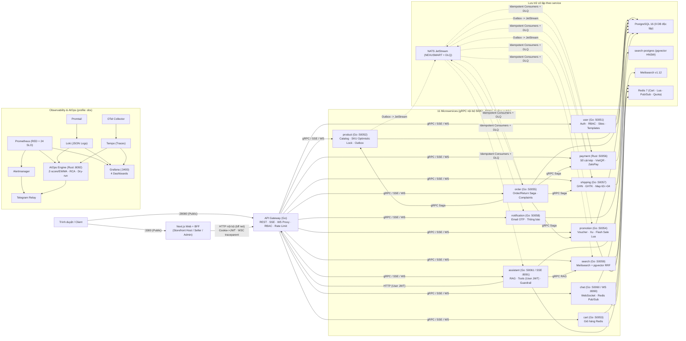

# Báo cáo Tổng kết Hệ thống – NexusMart (`docs/FINAL_REPORT.md`)

- **Phiên bản báo cáo:** Tổng kết toàn hệ thống sau hoàn thiện Giai đoạn 6 tháng (nhánh `phase-0b`, ngày `2026-11-21`).
- **Tài liệu liên quan:** Đặc tả gốc [docs/spec.md](file:///home/dev/Documents/Nexus_Ecom/docs/spec.md), Bảng đánh giá định lượng [docs/EVAL_REPORT.md](file:///home/dev/Documents/Nexus_Ecom/docs/EVAL_REPORT.md), Kịch bản Demo 15 phút [docs/DEMO.md](file:///home/dev/Documents/Nexus_Ecom/docs/DEMO.md), Quyết định kiến trúc Template [docs/adr/0001-site-template-format.md](file:///home/dev/Documents/Nexus_Ecom/docs/adr/0001-site-template-format.md), Nhật ký lỗi liên swarm [docs/reports/issues.md](file:///home/dev/Documents/Nexus_Ecom/docs/reports/issues.md).

---

## 1. Tổng quan Kiến trúc Hệ thống

NexusMart là nền tảng thương mại điện tử đa gian hàng cho phép mỗi người bán vận hành **site cửa hàng độc lập theo tên miền phụ hoặc tên miền riêng** (host isolation), đứng sau **1 API Gateway**, **11 microservice nghiệp vụ độc lập**, **1 AIOps Engine viết bằng Rust**, **1 ứng dụng Web Next.js BFF** (3 vai trò: Người mua, Người bán, Quản trị), và **stack Observability đầy đủ** (Prometheus, Alertmanager, Loki, Promtail, Tempo, Grafana, Telegram Relay).

### 1.1 Sơ đồ kiến trúc tổng thể

### 1.2 Ma trận 11 Microservice + AIOps + Gateway + Web

| Thành phần | Ngôn ngữ | Cổng nội bộ (gRPC / HTTP) | CSDL / Hạ tầng riêng | Trách nhiệm chính |
|---|---|---|---|---|
| **gateway** | Go 1.22 | `—` / `0.0.0.0:28080` | Redis (rate limit) | Cổng REST/SSE/WS duy nhất, xác thực JWT, RBAC biên, rate limit IP/User, OTel propagation |
| **web** | TypeScript / Next.js `15.5.29` | `—` / `0.0.0.0:3300` | Stateless BFF | Host-isolated storefronts (`*.nexusmart.localhost`, custom domain), Seller Studio (8 templates), Admin Portal |
| **user** | Go 1.22 | `50051` / `127.0.0.1:8081` | `user_db` | Argon2id auth, JWT 15m + rotating refresh, RBAC, shop KYC, audit log append-only, site templates & custom domains |
| **product** | Go 1.22 | `50052` / `127.0.0.1:28082` | `product_db` | Danh mục, sản phẩm/SKU, optimistic locking tồn kho, giữ tồn Flash Sale Phase 2b, transactional outbox `product.*` |
| **cart** | Go 1.22 | `50053` / `127.0.0.1:28083` | Redis | Giỏ hàng đa gian hàng, kiểm tra tồn kho thực |
| **promotion** | Go 1.22 | `50054` / `127.0.0.1:8084` | `promotion_db` + Redis Lua | Voucher sàn/shop/freeship, xu thưởng, Flash Sale nguyên tử bằng Lua Redis, consumer `order.completed`/`order.refunded` |
| **order** | Go 1.22 | `50055` / `127.0.0.1:28085` | `order_db` | Saga orchestration đặt hàng đa shop, Idempotency-Key, máy trạng thái đơn & trả hàng, Refund Saga, khiếu nại admin |
| **payment** | **Rust** (Axum/Tonic) | `50056` / `127.0.0.1:8086` | `payment_db` | Tiền nguyên VND, sổ cái ghi kép bất biến, COD/VietQR/ZaloPay v2, webhook HMAC/replay/10x idempotent, đối soát & số dư seller |
| **shipping** | Go 1.22 | `50057` / `127.0.0.1:8087` | `shipping_db` | Interface `Carrier` (GHN, GHTK, Mock), resilience (timeout/retry/circuit breaker), vận đơn hoàn, polling dự phòng, mapping 63→34 tỉnh |
| **notification** | Go 1.22 | `50058` / `127.0.0.1:8088` | `notification_db` + Mailpit | Consumer NATS idempotent gửi email OTP & thông báo đơn hàng, DLQ có che OTP/PII |
| **search** | Go 1.22 | `50059` / `127.0.0.1:8089` | `search_db` (pgvector) + Meilisearch | Chuẩn hóa dấu tiếng Việt (`đ→d`), tìm kiếm hybrid Meilisearch + pgvector 256-dim RRF, facet, suggest, `SimilarProducts` cho AI |
| **chat** | Go 1.22 | `50060` / `127.0.0.1:28090` | `chat_db` + Redis Pub/Sub | WebSocket `coder/websocket`, single-use `?ticket=`, nhiều instance qua Redis Pub/Sub, cursor sync `before`/`after`, auto-reply, kiểm tra ảnh chống SSRF |
| **assistant** | Go 1.22 | `50061` / `127.0.0.1:28091` | `assistant_db` + Redis Lua | SSE streaming, RAG sản phẩm (gọi gRPC `search`, cô lập `shop_id`), RAG chính sách, 6 tools chạy bằng JWT user, guardrail 36/36, quota/chi phí VND |
| **aiops** | **Rust** (Tokio/Axum) | `—` / `127.0.0.1:8092` | Stateless (Prom/Loki/Tempo) | Phát hiện bất thường Z-score + EWMA, gom ngữ cảnh Loki/Tempo/Deploy (che PII), RCA LLM, tự khắc phục allowlist + giới hạn/giờ + `dry-run` |

---

## 2. Các Quyết định Kỹ thuật Trọng yếu

1. **Database-per-Service & Giao tiếp bất đồng bộ tin cậy (Outbox + JetStream + DLQ):**
   - Mỗi microservice sở hữu cơ sở dữ liệu độc lập (9 DB trong PostgreSQL 16 + `search_db` riêng chạy `pgvector/pgvector:pg16`); tuyệt đối không truy vấn SQL chéo service.
   - Mọi sự kiện nghiệp vụ quan trọng (`product.*`, `order.*`, `payment.*`, `shipment.*`) được ghi vào bảng `outbox_events` trong cùng transaction DB trước khi relay lên NATS JetStream (`NEXUSMART`) kèm header `Nats-Msg-Id` và W3C `traceparent`. Consumer kiểm tra idempotency theo `processed_events`, retry có backoff, và định tuyến lỗi bền vững sang `NEXUSMART_DLQ` (đã che OTP/PII ở `notification`).

2. **Tài chính nguyên VND & Sổ cái ghi kép bằng Rust (`services/payment`):**
   - Mọi số tiền lưu bằng `BIGINT`/`i64` đơn vị VND (không dùng float). Mọi giao dịch thanh toán, giải ngân ký quỹ và hoàn tiền (trước hoặc sau đối soát) đều sinh cặp bút toán đảm bảo bất biến `SUM(debit) == SUM(credit)`.
   - Sau vòng review bảo mật (Swarm D2), bổ sung `Config::validate()` fail-fast ở `APP_ENV=production` và guard phòng thủ sâu tại route `/webhooks/{zalopay,vietqr,payment}` để **không bao giờ** chấp nhận chữ ký từ hằng/placeholder mock trong repo ở môi trường production, trong khi giữ nguyên khả năng demo/E2E ở `development`.

3. **Kiểm soát tranh chấp tồn kho & Flash Sale nguyên tử:**
   - Giữ tồn kho thông thường theo SKU bằng **optimistic locking** (`version`), tách bạch hạn mức `flash_sale_reserved_stock` (Phase 2b) để đơn thường không ăn vào suất Flash Sale và ngược lại.
   - Trừ suất Flash Sale và lượt voucher bằng **Lua script trên Redis**, đảm bảo tuyệt đối `oversell = 0` dưới 1.000 yêu cầu đồng thời cho 100 suất.

4. **Cô lập đa gian hàng theo Host & Định dạng Site Template (`ADR-0001`):**
   - Mỗi gian hàng chạy trên một host riêng (`*.nexusmart.localhost` hoặc custom domain đã xác thực như `hanoi-knit.verified.test`) với session cookie host-only, CSRF origin check, khóa cứng `shop_id` từ `Host` trên BFF (người mua ở site A không thấy đơn/giỏ/chat/AI của site B; các tuyến `/api/seller/*` và `/api/admin/*` trả `404` trên site host).
   - Qua biểu quyết **3–0** ([ADR-0001](file:///home/dev/Documents/Nexus_Ecom/docs/adr/0001-site-template-format.md)), chọn **`Declarative Theme JSON v2`** thay vì Liquid DSL hay MDX: thuần dữ liệu, không thêm runtime dependency, đồng bộ 1–1 giữa trình sửa trực quan và trình sửa mã báo lỗi theo `Dòng/Cột`, kiểm tra trước giải mã (kích thước `<= 128 KiB`, độ sâu `<= 8`, cấm khóa trùng lặp), chặn XSS/SVG/SSRF, kiểm tra tương phản WCAG AA `>= 4.5:1`, tương thích ngược 4 site v1 và lưu phiên bản bất biến `site_versions`.

5. **Tìm kiếm Hybrid Tiếng Việt (Meilisearch + pgvector RRF) & Trợ lý AI không có quyền riêng:**
   - `services/search` chuẩn hóa tiếng Việt (`đ/Đ → d`, NFD strip dấu) để truy vấn có dấu và không dấu cho kết quả đồng nhất, kết hợp Meilisearch và pgvector HNSW (256-dim) bằng **Reciprocal Rank Fusion (`k=60`)**, tự suy giảm mượt khi một backend gặp sự cố, và cung cấp gRPC `SimilarProducts` cho `assistant` (không nhân bản kho vector).
   - `services/assistant` tuân thủ nguyên tắc đặc quyền tối thiểu: mọi tool (`get_order_status`, `add_to_cart`, `get_seller_report`, `handoff_to_agent`) chỉ chuyển tiếp **nguyên trạng JWT của người dùng cuối**, không có service token riêng, không có tool tự checkout/thanh toán hay sinh SQL; đầu vào/dữ liệu không tin cậy/đầu ra đều qua lớp guardrail chặn prompt injection (36/36 ca) và che PII/secret.

6. **Bảo mật gRPC nội bộ & Khả năng quan sát đầu-cuối (OpenTelemetry + AIOps):**
   - `pkg/common/auth` áp đặt xác thực JWT cho cả cuộc gọi gRPC giữa các service (chặn gọi ẩn danh và giả mạo metadata); chỉ mở duy nhất 2 cổng public (`28080`, `3300`).
   - Toàn bộ service xuất log JSON có `trace_id` (che PII/JWT/DSN), metric RED Prometheus và OTel trace về Tempo (xác minh sống `gateway → search` trả `HTTP 200` trên Tempo `:3200`).
   - `services/aiops` (Rust) chạy nhẹ (~21 MiB RAM), tách biệt phát hiện bất thường thống kê (Z-score + EWMA) khỏi tầng phân tích ngữ cảnh (Loki + Tempo + deploy history) và tầng thực thi tự khắc phục an toàn (allowlist `restart`/`scale`, giới hạn 3 lần/giờ, `dry-run=true` mặc định).

---

## 3. Tổng hợp Kết quả Thực hiện theo các Swarm

| Swarm | Phạm vi chính | Kết quả định lượng nổi bật | Báo cáo chi tiết |
|---|---|---|---|
| **A (`search`)** | `services/search`, `product` outbox, `tools/catalog-gen` | 20.000 SP nạp qua gRPC trong `34.3 s` (`583.5 SP/s`); live k6 qua Gateway **p95 `42.97 ms`** (`< 200 ms`); sync realtime **`368.5 ms`** (`< 5 s`) | [search.md](file:///home/dev/Documents/Nexus_Ecom/docs/reports/search.md) |
| **B (`chat`)** | `services/chat` (WS + Redis Pub/Sub) | 2-instance Redis Pub/Sub PASS; **1.000 kết nối WS đồng thời** (`0` lỗi, `0` drop, connect p95 `34.73 ms`, RSS `71 MB`) | [b-chat.md](file:///home/dev/Documents/Nexus_Ecom/docs/reports/b-chat.md) |
| **C (`assistant`)** | `services/assistant`, `evals/assistant` | Eval **100/100** (`Grounded 100%`, `Hallucination 0%`, `Shop Isolation 100%`); Prompt Injection **36/36**; live SSE TTFT **`46.43 ms`** | [c-assistant.md](file:///home/dev/Documents/Nexus_Ecom/docs/reports/c-assistant.md) |
| **D (`order-depth`)** | `order`, `payment`, `shipping`, `promotion` | Return/Refund Saga, ZaloPay v2, GHTK, map 63→34 tỉnh, gRPC wire contract tests; coverage: **`order 65.9%`, `payment 85.25%`, `promotion 68.5%`, `shipping 62.9%`** | [d-order-depth.md](file:///home/dev/Documents/Nexus_Ecom/docs/reports/d-order-depth.md) |
| **D2 (`payment-fix`)** | `services/payment`, `deploy/helm/payment` | Vá lỗ hổng chấp nhận mock-key ở production cho ZaloPay, VietQR & webhook chung; `61` unit + `3` PG17 integration + Helm/kubeconform PASS | [d2-payment-fix.md](file:///home/dev/Documents/Nexus_Ecom/docs/reports/d2-payment-fix.md) |
| **E (`aiops`)** | `services/aiops`, `deploy/observability`, `tools/chaos` | 16/16 Prometheus targets `up`, 4 Grafana dashboards, 24 SLO rules, 98 alerts trên Telegram mock; **5/5 kịch bản Chaos phát hiện `< 31 s` & `5/5` đúng RCA** | [e-aiops.md](file:///home/dev/Documents/Nexus_Ecom/docs/reports/e-aiops.md) |
| **F (`platform`)** | `deploy/helm`, `deploy/k8s`, CI, `tests/load`, `tests/playwright`, `tools/backup` | 14 Helm charts (**28/28** lint + `kubeconform`), deploy + HPA + rollback 1 lệnh trên `kind`; Flash Sale **100/100 (`oversell=0`)**; Restore Drill **9 DB / 77 bảng / 328.473 dòng khớp 100%**; CI chỉ `workflow_dispatch` | [f-platform.md](file:///home/dev/Documents/Nexus_Ecom/docs/reports/f-platform.md) |
| **G + G2 (`web` & `web-fix`)** | `web/` (search, chat, assistant, returns, seller, admin) | Thay sạch 3 màn mock Seller, hoàn thiện Admin khiếu nại/cấu hình, vá `QA-01`, `QA-02`, `OBS-11`, `PLT-02` (`next@15.5.29` → **`0 vulnerabilities`**); **191/191** unit tests, `eslint`/`prettier`/`tsc`/`next build` 58 routes PASS | [g-web.md](file:///home/dev/Documents/Nexus_Ecom/docs/reports/g-web.md), [g2-web-fix.md](file:///home/dev/Documents/Nexus_Ecom/docs/reports/g2-web-fix.md) |
| **T (`templates`)** | `services/user/internal/site`, `web/src/features/site`, Seller Studio | ADR-0001 (3–0), **8 template** bố cục độc lập phủ 5 trang, visual ↔ JSON code editor, tích hợp 5 component Swarm G, chống XSS/SSRF/SVG | [t-templates.md](file:///home/dev/Documents/Nexus_Ecom/docs/reports/t-templates.md) |
| **K (`core-fix`)** | `pkg/common`, `infra`, `gateway`, `cart`, `notification`, `chat`, `assistant`, `.dockerignore` | Vá `K-01`, `K-02`, `OBS-01` (OTel→Tempo), `OBS-03` (PII/JWT scrubber), `OBS-07/08/09/13`, `PLT-04/06` (`USER 10001:10001`, build context ~560 KB) | [k-core-fix.md](file:///home/dev/Documents/Nexus_Ecom/docs/reports/k-core-fix.md) |
| **H (`qa-docs`)** | `tests/e2e/16..20`, `tests/e2e-web/06..08`, `tools/seed`, `docs/` | Tích hợp & dựng toàn stack 29 container, sửa `PLT-01` + nạp 20k SP idempotent, chạy `make lint`/`make test` xanh, `make e2e-web` **41/41 x2 PASS**, `16..20` **5/5 PASS**, đo live k6 Search 20k & Restore Drill 9 DB, phát hiện & lập hồ sơ `QA-01..QA-04` | [h.md](file:///home/dev/Documents/Nexus_Ecom/docs/reports/h.md) |

---

## 4. Giới hạn Trung thực & Hướng Phát triển Tiếp theo

Nhằm bảo đảm tính khách quan cho hội đồng đánh giá và người vận hành:

1. **Hai lỗi hồi quy liên swarm phát hiện ở vòng tích hợp cuối (đã cô lập rõ nguyên nhân, chưa sửa do ngoài phạm vi sở hữu Swarm H):**
   - **`QA-03` (High):** Quy tắc chặn `.local` trong `services/user/internal/site/validate.go:513` (Swarm T) xung đột với URL test cũ `https://sandbox.nexusmart.local/banners/site-hero.jpg` ở `tests/e2e/13_sites_backend_test.go:32` (ảnh hưởng bài `13` & `15`, khiến `make e2e` đạt `18/20` PASS). Chỉ cần đổi URL fixture bài `13` sang `https://cdn.example.com/...` là `make e2e` đạt `20/20` trong khi vẫn giữ nguyên bảo vệ SSRF `.local`.
   - **`QA-04` (Medium):** `tests/playwright/specs/buyer-flow.spec.ts:94` (Swarm F) vẫn trỏ selector `#site-search-input` cũ sau khi trang `/tim-kiem` chuyển sang `SiteSearchResults` / `SiteSearchBar` (Swarm G/T). Chỉ cần cập nhật selector sang `main [role="combobox"]`.

2. **Tải đồng thời cao 200 VU trên môi trường Compose đơn lẻ (`PLT-07`):**
   - Trên máy sạch có rate limit tiêu chuẩn (`180 req/phút/user`), k6 200 VU tạo `3.381` đơn COD trong 30 giây đạt `Read p95 = 38.75 ms` (`< 300 ms`) và `Checkout p95 = 204.95 ms` (`< 1.000 ms`) với `0` lỗi 5xx. Tuy nhiên, khi chạy không giới hạn rate limit (0 lỗi 429) trên duy nhất 1 container Postgres + 1 replica Go chịu tải CPU nặng, p95 vượt ngưỡng (`1.914 ms` đọc / `7.946 ms` checkout, `0,23%` 5xx do tranh chấp optimistic lock). Triển khai sản xuất đòi hỏi kích hoạt HPA đa replica trên Kubernetes (đã chuẩn bị sẵn trong `deploy/helm/{gateway,order,search}`) và tối ưu `pgxpool` + backoff retry SKU.

3. **Các tích hợp bên ngoài chạy ở chế độ mock mặc định khi không có secret:**
   - Claude API (`LLM_MODE=anthropic`), Voyage Embedding (`EMBED_MODE=voyage`), ZaloPay Sandbox, payOS/SePay, GHN/GHTK thật và Telegram Bot API thật đều đã có adapter chuẩn kèm resilience và unit test HTTP mock, nhưng chưa gọi live trong vòng kiểm thử này do chính sách không commit khóa bí mật vào repo.

4. **Một số hạng mục hoàn thiện vận hành nhỏ còn mở:**
   - Hoàn thiện `OBS-09`/`OBS-13` & `PLT-04` cho `services/user` (`ProcessCollector`, JSON fatal log, `USER 10001:10001`), `PLT-04` cho `product`/`search`, `PLT-05` (multi-stage cho `telegram-relay`), và nâng Go toolchain từ `1.22` lên bản được hỗ trợ dài hạn (`PLT-06`).
   - Bổ sung `ZALOPAY_KEY1`, `ZALOPAY_KEY2` vào `deploy/k8s/create-secrets.sh` cho môi trường `nexusmart-production` (theo khuyến nghị của Swarm D2).
   - Bổ sung job nền nhập file CSV sản phẩm cho người bán (mục con trong hàng "Người bán và quản trị") và thông báo đẩy `chat.message_created` sang `notification` khi người nhận chat đang offline.
